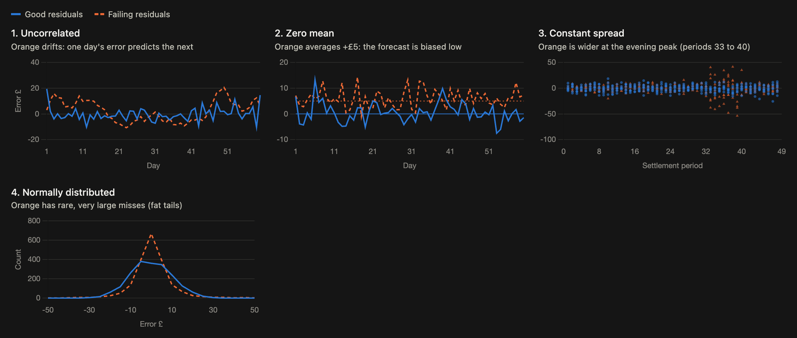

# Week 01 notes

## Simple forecasting methods

- Mean method: forecast every future value with the average of the past.
- Naive method: forecast with the last observed value.
- Seasonal naive: forecast with the value from the same season last time, for example the same half-hour one week ago.
- Drift method: the naive forecast plus the average change per step, (last − first) / (T − 1).

### Fitted values against forecasts

A fitted value is the model's prediction for a point already in the data, made after fitting the model to the whole series. With prices 100, 110, 90, 120 and 130, the mean method's fitted value for day 2 is 110, the average of all five days. That average uses days 3 to 5, which had not happened on day 2, so the fitted value is not a true forecast. A forecast made at the end of day 1 could only use 100.

The naive and seasonal naive methods estimate nothing from the data, so their fitted values are true forecasts. This is why models are scored with a backtest, where each forecast uses only the data before it.

### Exogenous regressors

An exogenous regressor is an extra input from outside the series, such as the day of the week or a wind forecast. A model that uses one needs its values for the future periods too, passed as a table of future rows (`X_df` in the Nixtla code). Only inputs known at the forecast time can be used: weekday and the wind forecast qualify, but the net imbalance volume for tomorrow does not.

The simplest regressor is a `trend` column that counts time steps (1, 2, 3, ...). It lets a linear model fit y = a + b × trend, and its future values are always known.

## Residuals and what good residuals look like

We take logs when the data grows by percentages. The log turns percentage changes into equal steps, which most models handle well. Take sales that grow 10% a year: 100, 110, 121, 133. In raw numbers the yearly rise gets bigger each year: 10, 11, 12. Their logs are 4.61, 4.70, 4.80, 4.89, which rise by the same 0.095 every year, so a curve that keeps steepening becomes a straight line.

Innovation residuals are the errors on the scale the model works on. If the model forecasts w_t = log(y_t), the innovation residuals are measured in logs, so they compare like with like. Without a transformation they equal the ordinary residuals, actual minus forecast.

### The four checks

| Check | Name when it fails | Test | Fixable? |
|---|---|---|---|
| 1. Uncorrelated | Autocorrelation | Ljung-Box | Yes: the errors hold a pattern the model missed |
| 2. Zero mean | Bias | t-test on the mean | Yes: add the average error to every forecast |
| 3. Constant spread (homoscedasticity) | Heteroscedasticity | Breusch-Pagan, ARCH | Not necessarily |
| 4. Normally distributed | Fat tails, skew | Jarque-Bera, QQ plot | Not necessarily |

Checks 1 and 2 show whether the forecast left information unused. Checks 3 and 4 only matter for the simple interval formula, forecast ± 1.96 × the residual standard deviation. Passing all four does not make a method the best; the backtest score decides that.

Residuals that pass 1 to 3 are called white noise, after white light, which holds every frequency equally. If they also pass 4 they are Gaussian white noise, after Gauss and the normal distribution. For imbalance prices, expect checks 3 and 4 to fail because of evening peaks and spikes.

## Scale-dependent errors: MAE and RMSE

## Percentage and scaled errors, and why MAPE fails near zero prices

## Time series cross-validation

## Fitting by minimising squared error (Bishop 1.1)

## Overfitting, and how training and test error behave as a model gets more flexible

## Five-sentence explanation: why a random train/test split is wrong for a forecast

## Clock-change days: my decision

## Why not "same period one day back"?

## The last settlement period known at 12:00 UTC, winter and summer
